<p align="center">
  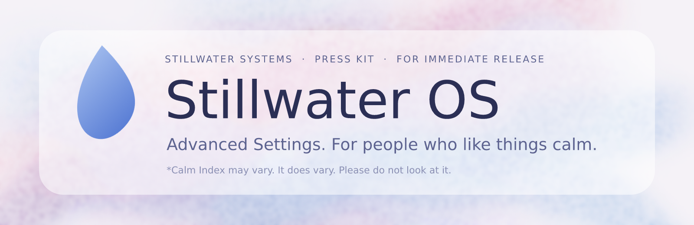
</p>

**FOR IMMEDIATE RELEASE** · *Stillwater Systems Communications · Office of Calm · Version 1.4.1*

# Introducing Stillwater OS: the workstation that wants you to relax

**STILLWATER, a body of water.** Stillwater Systems, the company that sells calm, is delighted to announce **Advanced Settings**, a playable edition of the Stillwater OS developer workstation. You sit down. You write software. You ship it. Nothing alarming happens.[^1]

> "We built a desktop where every window, menu and setting is exactly where you'd hope to find it," said **Pat Lull, VP of Serenity**. "Nobody has ever been lost in a Stillwater menu. Some people have gone *deeper*, which is a different thing, and I'd like us to stop asking about it."

Advanced Settings is a **menu-driven incremental puzzle game**. It is set on a company workstation that is, we are told, only *slightly* suspicious. Everything runs on your own machine. There are no accounts, no paid APIs and no real AI calls.[^2] The web is simulated, and the filter is real.

> *[Based on the concept sheet](Advanced-Settings-Game-Concept.md), which Legal asked us to describe as "a document."*

<p align="center">
  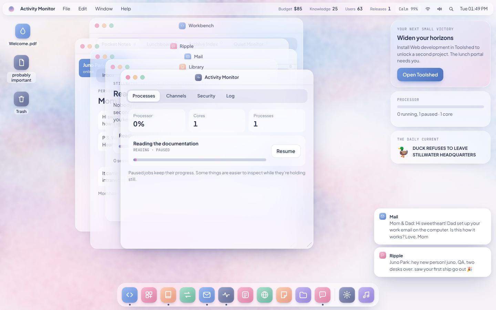
  <br><em>Figure 1. Your new desktop. Please admire the wallpaper. The wallpaper is fine. (A fading wallpaper is not a symptom of anything.)</em>
</p>

---

## Why Stillwater OS?

<table>
<tr>
<td width="200" align="center">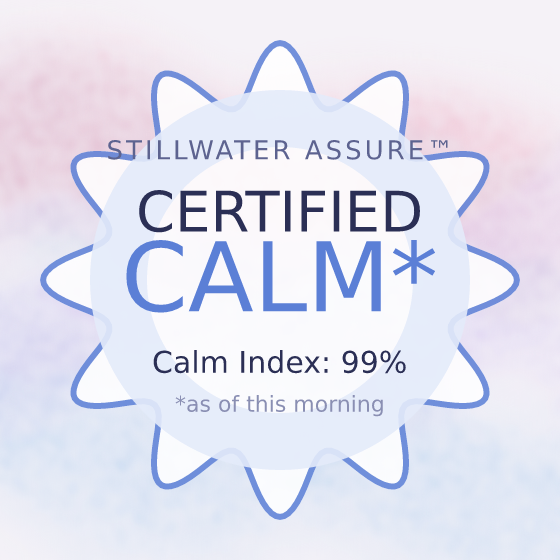</td>
<td>

- **Certified Calm\*.** Every workstation ships with a **Calm Index**, a friendly number in the menu bar, currently reading 99%. It is a reflection of how you are doing. It is not a score, and nothing in the product is hurt when it falls.
- **A genuine desktop.** Drag, resize, minimize and zoom windows. Open menus from the menu bar. Right-click the desktop. Drag things to the Trash. Press <kbd>Ctrl</kbd>+<kbd>K</kbd> to search.
- **Reassuring, quiet and always on.** Lock the screen when you step away. If you step away for long enough, the screensaver takes over and keeps the place warm.
- **A bit of a challenge.** Advanced Settings is meant to be a **difficult puzzle game**. Most of what matters is hidden, and the hints are small. We call this "discoverability."

</td>
</tr>
</table>

*\*Calm Index may vary. See Footnote 4, Footnote 11 and the footnote that was removed from Footnote 11.*

---

## Quick start

### Windows (recommended by us, and by the installer)

Download `Advanced-Settings-Setup-<version>.exe` from the [latest release](https://github.com/jxburros/Advanced-Settings/releases/latest) and run it.

The Windows edition updates itself, and it installs DLC from **Software Update** (logo menu, or System Settings › About). It also asks nothing of you, ever.

> **A note on trust.** The installer isn't code-signed yet, so Windows may ask you to confirm ("More info › Run anyway"). We know how that looks. It is a *paperwork* issue. Please click it.

### In a browser

You'll need Python 3 or any static web server. No build and no dependencies are required. Nothing needs to be installed, and nothing is.

```sh
python3 -m http.server 8000
```

Then open **http://localhost:8000**. (`npm start` does the same thing, with more typing.)

**Keep these files together:** `index.html`, `style.css`, `app.js`, `game.js`, `tasks.js`, `stories.js`, `sound.js` and `assets/`.

**Do not open the HTML as a `file://` URL.** The browser needs HTTP to load JavaScript modules. We'd explain more, but the answer is not interesting, and the interesting answer is under review.

---

## Your first day at Stillwater

You are a **new developer**. Welcome! You have a desk, a workstation and a mug. The workstation's previous user is no longer in the building, for ordinary reasons we are not at liberty to rank.[^3]

<table>
<tr>
<td>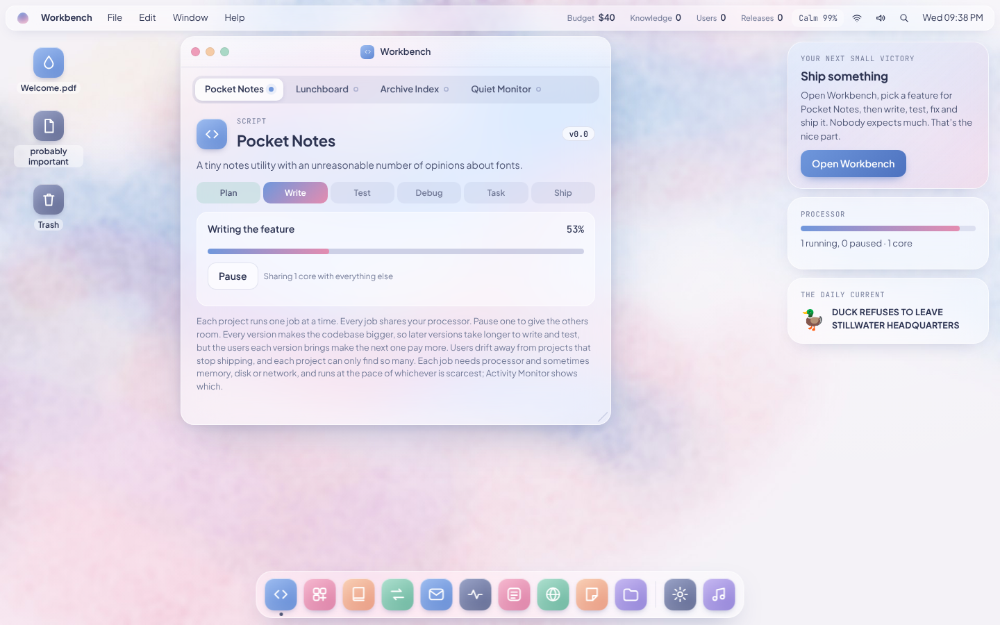</td>
<td>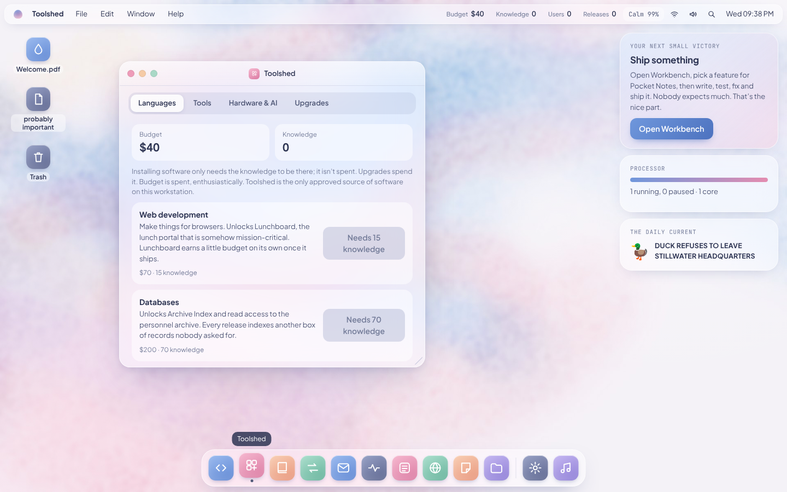</td>
</tr>
<tr>
<td align="center"><em>Figure 2. Workbench. Choose a feature, write, test, debug, ship. Pocket Notes has "an unreasonable number of opinions." That is its charm.</em></td>
<td align="center"><em>Figure 3. Toolshed, "the only approved source of software." Please note the word <strong>only</strong>.</em></td>
</tr>
</table>

### The Stillwater Way™

1. **Open Workbench.** Pick a feature for Pocket Notes.
2. **Write it, test it, fix it, ship it.** Nobody expects much. That's the nice part.
3. **Spend your budget** in Toolshed on languages, tools, hardware and AI help. Install things. Wonder why you want them.
4. **Read the documentation** in Library while other jobs run. It earns you knowledge, and some of the footnotes are load-bearing.
5. **Get promoted.** Eventually. Once all of the above has made you very, very good at your job, and you have dealt with whatever it is that only you can deal with.

Before most versions ship, there is also a short **release task**, which is a small chore we call a *moment of mindfulness*. The scheduler won't do these for you. An AI assistant assigned to development will, slowly, and nobody should ask who it reports to.

### Controls

| You want to… | You… |
| --- | --- |
| Move, resize, minimize or zoom a window | Drag it, or use the three little dots in the corner |
| Select several icons | Click-drag a selection box |
| Open something | Double-click it |
| Get rid of something | Drag it to the **Trash**. The Trash is fine. |
| Find anything | <kbd>Ctrl</kbd>+<kbd>K</kbd>, or the magnifier in the menu bar |
| Check the time, the Wi-Fi, the sound | The menu bar. The calendar is *very* detailed |
| Hide from a manager | <kbd>Ctrl</kbd>+<kbd>Shift</kbd>+<kbd>L</kbd> locks the screen. We don't recommend hiding from a manager. We recommend knowing about this key |
| Slow the clock down | Settings › Appearance › **Relaxed timing**. Every time limit doubles. This isn't cheating. It's *ergonomics* |

---

## Meet the programs

Every Stillwater OS workstation includes a full suite of **fifteen** professionally calming applications.

| Program | What it does (per Marketing) |
| --- | --- |
| **Workbench** | One tab per project: choose a feature, write, test, debug, perform the release task, ship. Every project is unique. Please do not compare them. |
| **Toolshed** | Spend budget on languages, tools, hardware and AI help. Budget is spent *enthusiastically*. |
| **Library** | Read the documentation for knowledge while other jobs run. The documentation is comprehensive. Some of it is older than the company. |
| **Conductor** | The release pipeline, and the AI assistant's assignment. The assistant is *very* assigned. |
| **Mail** | Promotions, warnings, "office incidents," recovered mail from the previous user, and a **Personal** tab. We would like it noted that your parents found your work address *on their own*. |
| **Activity Monitor** | Processes, diagnostic channels, security incidents and the event log. There are four channels. We only talk about three. |
| **The Daily Current** | Duck headlines, and a corrections desk that only accepts the true explanation. There is no duck. See *Figure 7*. |
| **Wayfinder** | A web browser behind a company filter that blocks nearly everything. A few sites can be reached anyway. This is a *feature of the filter*. |
| **Ripple** | Instant messages from coworkers. Answer with choices, or type when you need to remember something. |
| **Notes** | Sticky notes, left by the previous user, found as you go deeper. We did not authorize this. We do not know where they come from. |
| **Files** | Discoveries and downloads. |
| **System Settings** | Appearance, sound, and settings that go much deeper than they look. Please do not go deeper than they look. |
| **Murmur** | A music player. It plays your tracks from `assets/music` ([how](assets/music/README.md)) and some built-in hold music. Our hold music is the most-played in the company. |
| **Help Desk** | Help › Help Desk: escalating hints for whatever you're stuck on. |
| **Software Update** | Checks GitHub for newer editions (and installs them in the Windows edition), and lists downloadable content. |

<table>
<tr>
<td width="50%">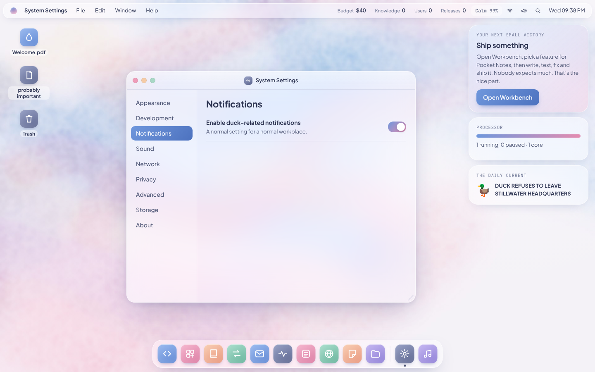</td>
<td width="50%">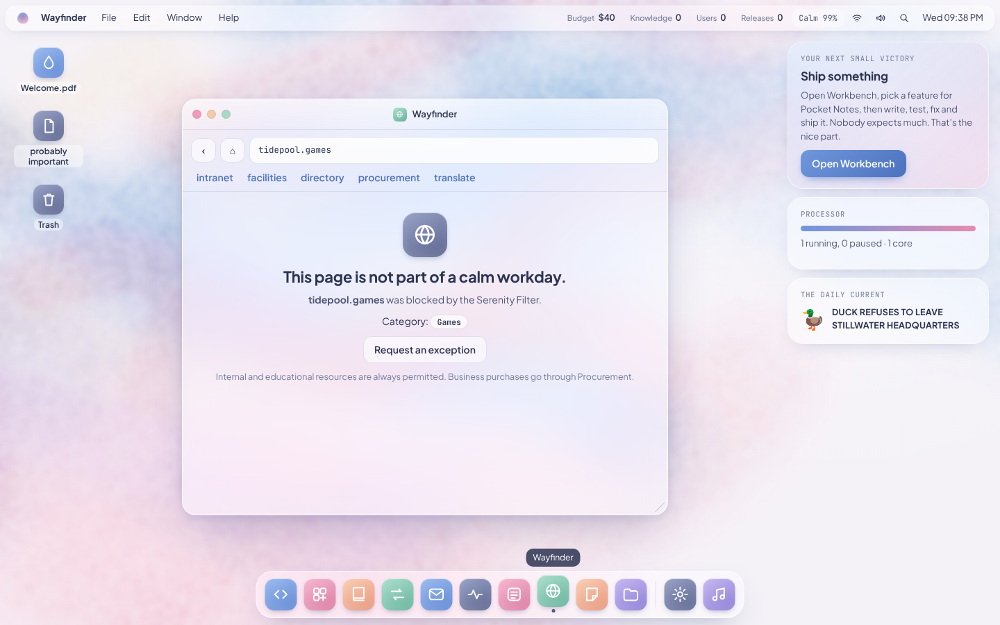</td>
</tr>
<tr>
<td align="center"><em>Figure 4. System Settings. "A normal setting for a normal workplace." Turning it off is not a normal thing to do.</em></td>
<td align="center"><em>Figure 5. The Serenity Filter, protecting you from games. Internal and educational resources are <strong>always</strong> permitted. (Again: <strong>always</strong>.)</em></td>
</tr>
</table>

<p align="center">
  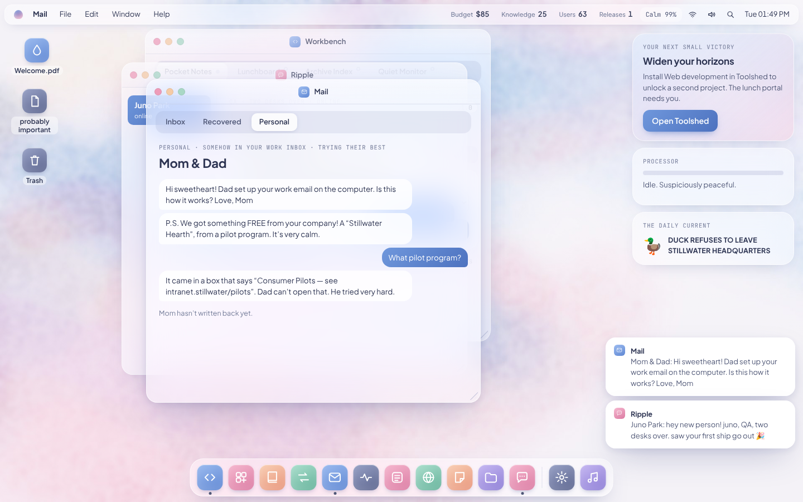
  <br><em>Figure 6. Mail › Personal. Customer feedback from <strong>Mom &amp; Dad</strong> (a pilot-program household). We've decided to treat it as a testimonial.</em>
</p>

---

## Features we're very proud of

- **Work.** Five projects, three features, nine tools to install and four upgrades to buy again and again, and five ranks (at 5, 15, 30 and 50 releases). Every promotion after the first also waits on a puzzle, which we like to think of as *a career conversation*.
  - Each project has its own release tasks: code review and bug triage (Pocket Notes), deploying between lunch rushes (Lunchboard), ordering a data migration (Archive Index), tuning a probe (Quiet Monitor) and decoding legacy notes (Workspace Zero). Tasks grow with each project and each version.
  - Each version takes longer to write and test than the last, so new projects pay off. Career tracks change how you work.
  - Each project keeps its own users: they pay while they stay, make the next version pay more, drift away from projects that stop shipping, and each project can only find so many. Speed boosts add up rather than multiply.
  - Lunchboard earns while it runs. Archive Index reveals records. Quiet Monitor shows what is watching you.
- **Puzzles.** Progress is never *only* a matter of shipping. Growth conversations go on hold until you deal with something only you can (an unsigned plugin, the credential behind it, what the previous user left offline), and the local model waits on a power panel. There's a deep settings maze, conditional discoveries, duck corrections that need evidence from elsewhere, a credential you have to work out, and three mini games: a sudoku, a breaker panel and a packet trace.
- **People.** Meet your colleagues. **Bella**, a friend from QA, goes on a wellness retreat and comes back *far too calm*. **Reggie** from Platform always wants to hear about your plans outside work, for reasons he can't say. Your parents have been sent Stillwater's *undisclosed* consumer products. **Greg** and the previous user each have a later chapter. Several of these stories connect to each other and to the puzzles. Please don't try to connect them.
- **Technical debt, resources and rules.** Ship with known bugs and pay it back later with a refactor. Jobs compete for processor, memory, disk and network. The release pipeline follows rules you set per project. (They are *your* rules. We have never once interfered with a pipeline.)
- **Handing over.** Once you're a Principal Engineer you can hand the workstation to its next user and start again with a legacy bonus and a note to yourself. Please read the previous sentence twice.
- **Product reviews.** One question early on and one per promotion, from pricing to telemetry, with consequences that turn up later somewhere else. We value your feedback. It has been collected.
- **Short incidents.** An all-staff reply-all storm, birthday cake that disappears quickly, an IT phishing test, and a manager who walks over while you're on a personal page.
- **Messing around.** Shopping, blogging and gaming on a work computer, each behind its own way past the filter. Personal use lowers your Calm Index. (*Lowers.* We said *lowers*.)
- **Help Desk.** Help › Help Desk takes a ticket for any open problem. The first answer is vague. Better answers unlock after a few minutes, and the last one is the solution. Our average ticket resolution time is five minutes and a bit. We are very proud of the "bit."
- **A title screen.** Continue Game, New Game, Options and Secrets, which collects every story moment, secret, ending and achievement from all your workstations. The logo is calm. The logo is *almost always* calm.
- **Secret Tracker.** After your first win or loss, a tracker appears in the dock. It lists every story moment (64, of which those marked "needed for probation" are required and many are optional or rule each other out), every secret (68) and every ending. It persists across new workstations. It is the only part of the system that remembers everything. That is considered a perk.
- **Sound.** Interface sounds (clicks, chimes, windows, alerts, a startup chord) are synthesized in the browser and can be switched off in the menu bar or System Settings › Sound.
- **Returning.** Closing the game and coming back (or leaving it in the background for 20 minutes) has a small effect each time, and it adds up. The desk remembers. We mean that warmly.
- **Everything else.** Automatic local saves (older saves are migrated), JSON backup/import, up to two hours of offline job progress (time away, including a background tab, can never lose you the game), a phone layout, keyboard controls and reduced motion.

<p align="center">
  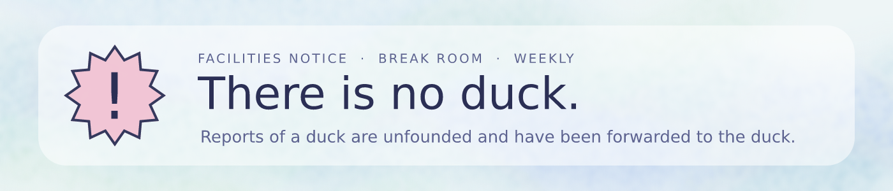
  <br><em>Figure 7. Our Facilities team would like to remind you about the break room.</em>
</p>

---

## Frequently asked questions

**Is the Calm Index a score?**
No. It's a mood. Moods go up and down. Yours goes down when you shop, blog or game on a work computer, and the index "reacts to your choices." It will drop faster the more you browse, and it was originally supposed to be called the *Stillwater Disapproval Meter*. We have rebranded.

**Is it possible to lose?**
Only a player who ignores the warnings will lose, and there are **two** ways. Both come with *several* warnings. Browsing too much gets you a **Calm Improvement Plan** first, so the first offence is a "learning opportunity." Only a second offence ends the workstation. The other way involves a helper nobody installed. (Please see Mail. Mail has been warning you.)

**Why is there a duck?**
There is no duck. If you see a duck, file a correction. The Daily Current's corrections desk only accepts the *true* explanation, which is always about snacks, warmth or doors.

**What's "probably important"?**
It's a file. It is a perfectly normal file. We have tried to throw it away more than once.

**Why does my workstation have so many notes from someone else?**
Because someone else was here first. Please don't read them. Please read *all* of them.

**What is Panel B?**
A power panel. It is stable. It has a maintenance window. The maintenance window is on Thursdays.

**Where can I find the answers?**
Full solutions are in [docs/SECRETS.md](docs/SECRETS.md). **It contains spoilers.** Our Help Desk would prefer you used the Help Desk.

---

## Specifications

| | |
| --- | --- |
| **Platforms** | Windows (installer, self-updating), any modern browser |
| **Server** | Python 3 or any static web server. No build. No dependencies. |
| **Accounts** | None |
| **Paid APIs / real AI calls** | None. The web is simulated |
| **Fonts** | Optional Google Fonts, falling back to system fonts |
| **Audio** | Synthesized with Web Audio. No audio files unless you add music |
| **Icons** | Inline SVG |
| **Wallpapers** | Watercolors in `assets/wallpapers`, painted with [Vixl](https://github.com/jxburros/Vixl). `tools/make-wallpapers.py` regenerates them, and `tools/make-cover.py` paints Murmur's cover art |
| **Layouts** | Desktop and phone. Keyboard controls. Reduced motion |
| **Saves** | Automatic local saves, JSON backup/import. Window layout and appearance are stored separately, so a save file never depends on screen size |
| **Data collected** | None.[^4] |

<p align="center">
  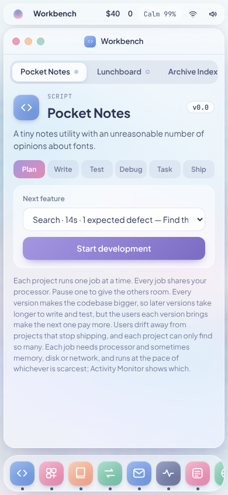
  <br><em>Figure 8. The <a href="docs/mobile.png">phone layout</a>. Calm, now in your pocket.</em>
</p>

---

## Meet Stillwater Hearth™ *(coming soon to a family near you)*

<p align="center">
  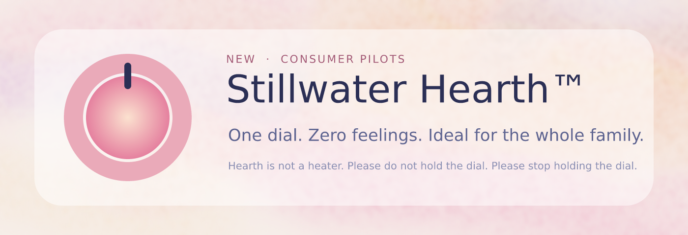
</p>

Stillwater Hearth is the first of our **Consumer Pilots**: warm, welcoming home appliances that help the whole family feel exactly the same. We are told they are shipping to a small number of households as "a surprise." Please direct any questions to the address on the box. The box's address is `intranet.stillwater/pilots`. The box is not responsible for the address.

---

# Appendix: for our engineering partners

*This section is internal and has been included in the public README by mistake. Please disregard. Please also don't mention it to Legal.*

### Releases, updates and DLC

On github.com, **Actions › Release › Run workflow** with a version (or no version, for a test installer) builds and publishes a release without a terminal. [docs/RELEASING.md](docs/RELEASING.md#from-the-github-website-no-terminal) walks through it click by click.

From a terminal, pushing a tag like `v1.2.0` does the same: tests, a self-updating Windows installer, a web-edition zip, and notes from [CHANGELOG.md](CHANGELOG.md).

Pushing `dlc-<id>-v1.0.0` publishes a DLC pack from `dlc/packs/<id>` and adds it to the catalog. The details, including signing and local builds, are in [docs/RELEASING.md](docs/RELEASING.md). The pack format is in [dlc/README.md](dlc/README.md).

The Windows edition is an Electron shell (`desktop/`) around the same files the web edition serves. The game itself still needs no build.

### Validation

Node.js 20+:

```sh
npm test
```

The engine tests cover release gating, every kind of release task (and that every generated task is solvable), story moments, resource sharing, career tracks, the filter and its workarounds, every mini game (including sudoku uniqueness and breaker solvability), both losses, the cross-play archive, returns, every story ending, and save restoration and migration.

Optional real-browser smoke tests (with the server running):

```sh
python -m pip install playwright
python -m playwright install chromium   # or set CHROMIUM=/path/to/chrome
python tests/browser.py
```

`python tests/browser.py` also regenerates the [desktop](docs/desktop.png), [mail and Ripple](docs/ripple.png) and [mobile](docs/mobile.png) previews.

### Implementation decisions

The concept deliberately leaves platforms, timing, economy, characters, and endings open. This implementation uses dependency-free browser modules, short tasks (8–22 seconds before modifiers, growing 60% per version written), permanent knowledge requirements, and spendable budget.

Mara Chen and Stillwater Systems are original names supplied for the playable story. All paths remain available regardless of career direction; the promotion choice is narrative, not a separate skill tree. There is a completion message after all four stories, followed by unlimited free play. Losing ends the workstation (the browsing loss only after one Calm Improvement Plan); a new one starts from scratch, but the Secret Tracker remembers. There is no backend.

Game rules live in `game.js`, release tasks in `tasks.js`, conversation scripts and incidents in `stories.js`, sounds and the music player in `sound.js`, and the desktop, windows, story moments and browser storage in `app.js`. Window layout and appearance preferences are stored separately from the game save. The Secret Tracker has its own storage key, so starting a new workstation never clears it. A return counts once per browser session, so reloading the page does not count.

### Unified release procedure

`release.json` is the authoritative release manifest. Keep configured embedded versions synchronized and advance affected apps (patch by default) before merging changes into main. The first adoption establishes a baseline; later PRs must pass **Release version validation**.

Use **Actions → Release → Run workflow** from **main**, choose stable or preview, and leave **dry_run** enabled first. Only apps ahead of their published version in their own namespace are selected. Build/test/sign all required packages before publishing. Tag pushes and merges no longer publish migrated apps automatically. After inspecting the dry run, dispatch with dry_run disabled and satisfy configured approvals. Published versions are never overwritten; use a new version for a correction.

See [.release/README.md](.release/README.md) for this repository's inventory, credentials, compatibility, and validation limits. Shared implementation: [JX Holdings release infrastructure](https://github.com/JX-Holdings-LLC/release-infrastructure).

### Credits

**Advanced Settings** is a game by **Jeffrey Guntly**, for **JX Holdings, LLC**: design, writing, programming and music.

- **Made with:** OpenAI Codex and Claude Desktop (programming), [Vixl](https://github.com/jxburros/Vixl) (wallpapers and art), and Song Deck with ACE-Step 1.5 (music).
- **Music:** every song is composed by Jeffrey Guntly. The list is in the game's Credits, which reads it from `assets/music/tracks.json`.
- **A note on AI:** AI was used in the production of this game. The game itself makes no AI calls.
- **Dedicated to LeahAnn,** my biggest fan, even if she pretends she isn't.

### How this brochure was made

The Stillwater art in `docs/art` was painted with [Vixl](https://github.com/jxburros/Vixl). `tools/make-readme-art.py` regenerates it:

```sh
PYTHONPATH=/path/to/Vixl/src python3 tools/make-readme-art.py
```

The new screenshots in `docs/img` come from the real game. With the server running, `python3 tools/make-readme-shots.py` retakes them. (Every screenshot in this document is the real game. We stand by the game.)

---

<sub>© Stillwater Systems. Stillwater, Stillwater OS, Stillwater Assure, Stillwater Hearth, Serenity Filter and the Calm Index are trademarks of Stillwater Systems, a company that is calm. Stillwater Systems makes no representations about ducks. Nothing in this document is a warranty, a promise, or a thing we are going to say again.</sub>

[^1]: "Nothing alarming happens" is a statement of intent, not a forecast.
[^2]: The local model needs a power panel. We are *looking into the panel.*
[^3]: The previous user has been reassigned. Their notes remain for training purposes. Please do not ask what they were training for.
[^4]: Data is collected locally, on your machine, by the workstation, for the workstation. It is not "shared" with Stillwater. Stillwater would not know what to do with it. (See: product reviews, telemetry.)
